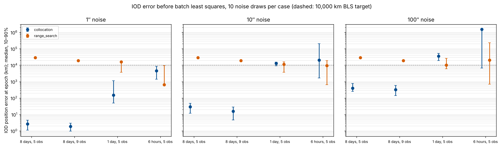
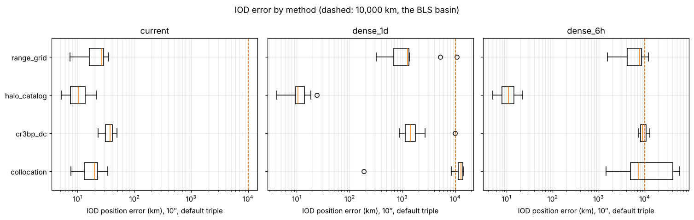

# Collocation IOD: does it work in our stack, and is it better?

Zohar and Keira's item for the week of 11/8. Tested on `main` at `7bdda95` (after the repository
restructure), November 9, 2026.

**Bottom line:** collocation works end to end in the stack, natively and in the product container.
On the 8-day arc of our scenario it is far better than the previous default, range search: it
lands 2–400 km from the truth instead of 19,000–29,000 km, batch least squares (BLS) then needs
3–4 iterations instead of 8–16, and it is several times faster. It is about as accurate as the
Part B methods (`range_grid`, `cr3bp_dc`) and less accurate than `halo_catalog` at high noise. **On
short arcs (1 day, 6 hours) it is unreliable**, worse than every Part B method, and changing its
settings does not fix that. Recommended: make it the default for multi-day arcs, and keep a
fallback for short arcs.

## 1. Does it work in our stack?

| Check | Result |
|---|---|
| Package tests (`packages/collocation-iod`, `packages/cislunar-stack`) | 62 passed |
| Bundled scenario (`cislunar-stack --config scenarios/plug_and_play/config.yaml`) | Runs: collocation → Orekit BLS → Orekit prediction in 8 s; IOD 18.3 km, final 15.1 km |
| CSV observations with no truth (`scenarios/observations`) | Runs; writes `state.json` (with covariance), trajectory, plot, `config_used.yaml` |
| `packages/collocation-iod/examples/verify_stack.py` | Final result reproduced (15.12 km, 52.92 km max). IOD 13.86 km here against 16.24 km recorded in the README (see 3.2) |
| Product container (`containers/Dockerfile`), first build | Builds; its built-in smoke run passes; `scripts/run_container.py` on the bundled scenario gives the same numbers as the native run |
| Configuration checks | Bad option values and unknown options are rejected with clear messages; two gaps (3.1, 3.4) |

The container was built on a network that needs a proxy certificate, so the build used a copy of
the Dockerfile with that certificate added and HTTPS package sources; nothing else changed. On a
normal network the original file should build as is.

## 2. How it compares

### Against range search and the two-body methods (on `main`)

`compare_iod.py`: the bundled halo scenario regenerated by the stack's own generator for 4 arcs ×
3 noise levels × 10 noise draws (720 runs). Every method sees the same observations. BLS then runs
from each IOD; "converged" means it reaches the fit that BLS reaches from the true state, within
10 km. That reference fit converged in all 120 cases.

| Arc | Noise | Collocation: median IOD error | Range search | BLS converged (collocation / range search) | BLS iterations (coll. / range) |
|---|---|---|---|---|---|
| 8 days, 5 obs (our scenario) | 1″ | **2.7 km** | 29,354 km | 10/10 / 10/10 | 3 / 16 |
| | 10″ | **30 km** | 29,354 km | 10/10 / 10/10 | 4 / 13 |
| | 100″ | **393 km** | 29,354 km | 10/10 / 10/10 | 4 / 10 |
| 8 days, 9 obs | 1″ / 10″ / 100″ | **1.9 / 16 / 320 km** | 19,354 km | 30/30 / 30/30 | 3–4 / 8–15 |
| 1 day, 5 obs | 1″ | **148 km** | 16,267 km | **9/10** / 2/10 | 4 / 10 |
| | 10″ | 13,110 km | 11,267 km | 4/10 / 5/10 | 14 / 6 |
| | 100″ | 35,828 km | **10,004 km** | 5/10 / **7/10** | 10 / 8 |
| 6 hours, 5 obs | 1″ | 4,619 km | **641 km** | 6/10 / 7/10 | 11 / 10 |
| | 10″ | 20,556 km | **9,359 km** | 6/10 / 7/10 | 10 / 7 |
| | 100″ | 1.5 million km | **20,642 km** | 3/10 / **10/10** | 10 / 11 |



- **On multi-day arcs collocation is a different class of method.** Range search's error is set by
  its 10,000 km grid spacing (the same ~29,000 km whatever the noise); it only works because BLS
  can recover from it. Collocation's error scales with the noise like a real estimator's, and BLS
  from it needs about as few iterations as from the truth.
- **Speed:** median IOD time on the 8-day arcs is 3–9 s (slowest at 1″; worst case 40 s), against
  about 21 s for range search. On short arcs both take about 2 s.
- **Reliability:** collocation returned a solution in 120 of 120 cases. Orekit's two-body methods
  (Gooding, Gauss, Laplace) returned one in 8 of 360, as expected for a halo orbit.
- **Short arcs:** from Earth's center the distance is barely observable over 1 day or less.
  Collocation then picks whichever trajectory fits the angles with the least control effort,
  which is not the most accurate one, and at 100″ on 6 hours it can be off by more than a million
  km. Range search's distance window (150,000–650,000 km) keeps it from going that far wrong.

### Against our Part B methods (from the `cr3bp-iod` branch)

`compare_with_part_b.py` runs Part B's benchmark harness with collocation added, so all methods see
identical noise draws: 3 arcs × 3 noise levels × 10 draws, then the robust BLS. These methods are not
on `main` yet.

| Arc, 10″ | Collocation | `range_grid` | `cr3bp_dc` | `halo_catalog` |
|---|---|---|---|---|
| 8 days: median IOD error, BLS converged | 20 km, 10/10 | 27 km, 10/10 | 37 km, 10/10 | **10 km**, 10/10 |
| 1 day | 12,692 km, 4/10 | 1,259 km, 9/10 | 1,403 km, 10/10 | **10 km**, 10/10 |
| 6 hours | 7,385 km, 6/10 | 7,779 km, 10/10 | 8,869 km, 7/10 | **11 km**, 10/10 |
| Median IOD time (8 days) | 3–15 s | 13–19 s | 47–49 s | **0.25 s** |



- **On the 8-day arc collocation matches the Part B methods** (2 / 20 / 408 km at 1 / 10 / 100″,
  against 2.5–3.7 / 10–37 / 96–378 km), and it is faster than `range_grid` and `cr3bp_dc`.
- **On short arcs it is the weakest.** `range_grid` and `cr3bp_dc` stay around 1,000–9,000 km and
  converge more often. `halo_catalog` stays at about 10 km on every arc, but only because it assumes
  the object is on the L1 halo family, which is true in this test.

### Its own settings (`settings_sensitivity.py`, 10″, 5 draws per arc)

| Setting | Effect |
|---|---|
| Starting guess | Matters. On the 8-day arc a line-of-sight start alone solves 1 of 5 cases, an L2 start 4 of 5; `auto` (try several) solves 5 of 5. Across the main benchmark the chosen start was L2 in 77 cases, line-of-sight in 42 and L4 in 1. |
| Which start `auto` keeps | It keeps the lowest control effort, which is not the most accurate: on the 1-day arc an L1 start gives 3,820 km, `auto` 13,119 km. |
| Mesh: 40 nodes | Fails the mesh check on every 8-day case (0 of 10). The default 80 works; 160 gives the same answers at about twice the time. |
| Range bound 150,000–650,000 km | No effect on short arcs (13,080 km against 13,119 km): their errors are already inside that window. |

An IOD-only check with a fixed (non-moving) observer away from Earth's center did not help on
short arcs either. That is expected: range becomes observable when the observer moves (a ground
station turning with the Earth, or a spacecraft), which the generator and BLS do not support yet.

## 3. What still needs cleaning up for integration

1. **Maneuver modes pass validation but are dropped.** `mode: impulsive` or `hybrid` is accepted
   with `estimator: orekit_bls`. The run completes without a warning, but BLS and the prediction
   assume no maneuvers, so the estimated maneuvers are silently discarded. The project docs say
   such combinations should fail validation. Either reject them before computation or carry the
   maneuvers through.
2. **Results differ between machines.** IPOPT is a local optimizer: the same input gives 13.86 km
   here and 16.24 km in the README's recorded run. Repeat runs on one machine are identical to the
   last digit. Reproducing a run (objective 6) therefore needs the pinned container image, and the
   README's recorded numbers should say which platform produced them.
3. **Short arcs need a fallback or a warning.** Options: choose among the starts by fit quality
   rather than control effort; run BLS from each candidate and keep the best fit that passes a 3σ
   residual check (what `range_grid` does); flag a short or weak-geometry arc; or fall back to
   `range_grid` or `halo_catalog` there. Bringing the Part B methods to `main` (they are still on
   `cr3bp-iod`) would make that possible.
4. **Mesh-size validation.** `nodes: 3` passes validation and 40 fails at run time on our arcs. The
   documentation should say 80 is the tested minimum, or validation should enforce a floor.
5. **No uncertainty from collocation itself.** `estimate.cov` is `None` (the paper derives none),
   so with `estimator: none` the product reports no covariance. Collocation alone is not yet a
   complete product estimate.
6. **Observer support.** Collocation accepts observer positions; BLS still requires Earth's center.
   A moving observer is what would help short arcs, so this is the next thing to test once the
   generator supports it.
7. **Containers.** The product image builds and runs, but its base image and Java runtime are not
   pinned (no digest, unpinned `apt` package), and it carries only leap-second data, enough for the
   synthetic scenario but not for real ephemerides. The `docker-image` branch (pinned base images,
   full `orekit-data` with DE-440) covers some of this; the two should be merged into one recipe.

## How to reproduce

From the repository root, with both packages installed
(`pip install -e "./packages/cislunar-stack[orekit]" -e "./packages/collocation-iod[stack,test]"`)
and `OREKIT_DATA` set:

```
python benchmarks/collocation_iod/compare_iod.py --out outputs/benchmarks/collocation_iod        # ~25 min, 3 workers
python benchmarks/collocation_iod/settings_sensitivity.py --out outputs/benchmarks/collocation_iod
```

The Part B comparison needs a `cr3bp-iod` checkout and an environment with that branch's
requirements plus `pip install ./packages/collocation-iod` (see the docstring of
`compare_with_part_b.py`). Outputs go to `outputs/`, which is not committed.
